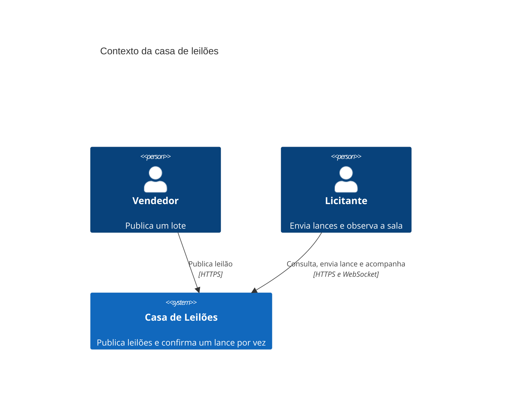
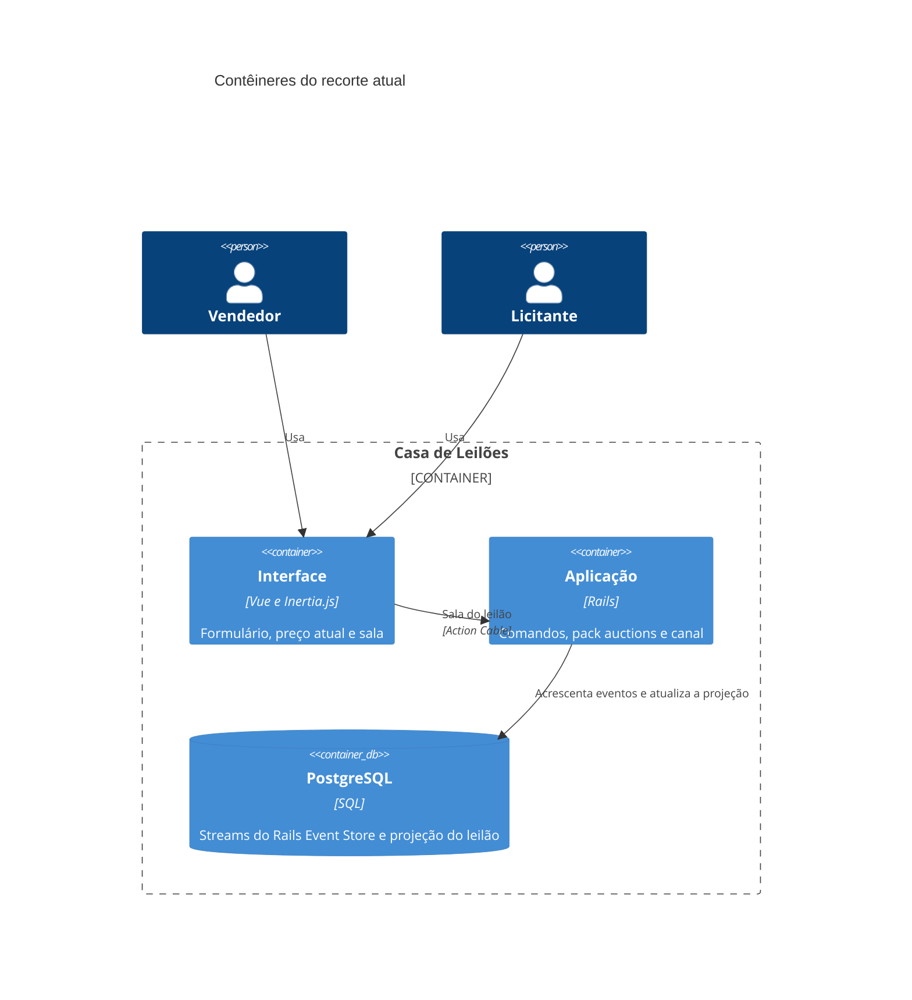
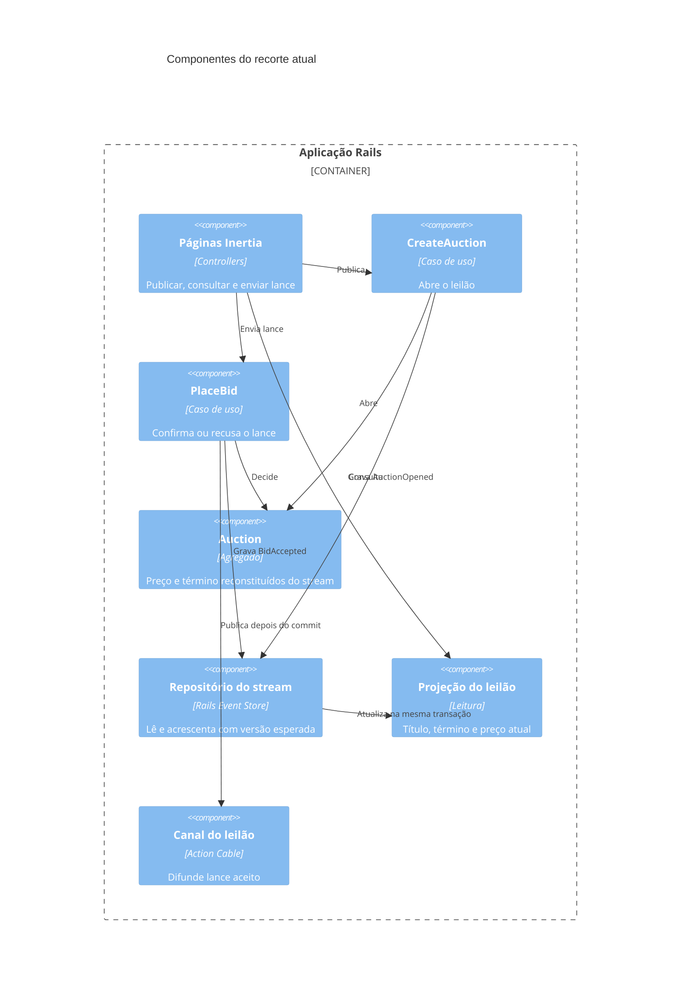

# Diagramas C4

Os nomes abaixo seguem o RFC: um pack `auctions`, event sourcing no stream do leilão e Action Cable só depois do commit.

## Contexto

## Contêineres

## Componentes

## Fronteiras entre packs

- `auctions` contém agregado, contratos, casos de uso, repositório do stream e projeção. Não referencia controller, sessão nem Action Cable.
- A camada web referencia apenas a API pública do pack: `CreateAuction`, `PlaceBid` e a consulta da projeção.
- O canal assina o resultado aceito; não reaplica a regra de lance.
- Nenhum outro pack existe neste change. `packwerk` deve recusar dependência de `auctions` para dentro do domínio a partir da web, exceto pela API pública.
