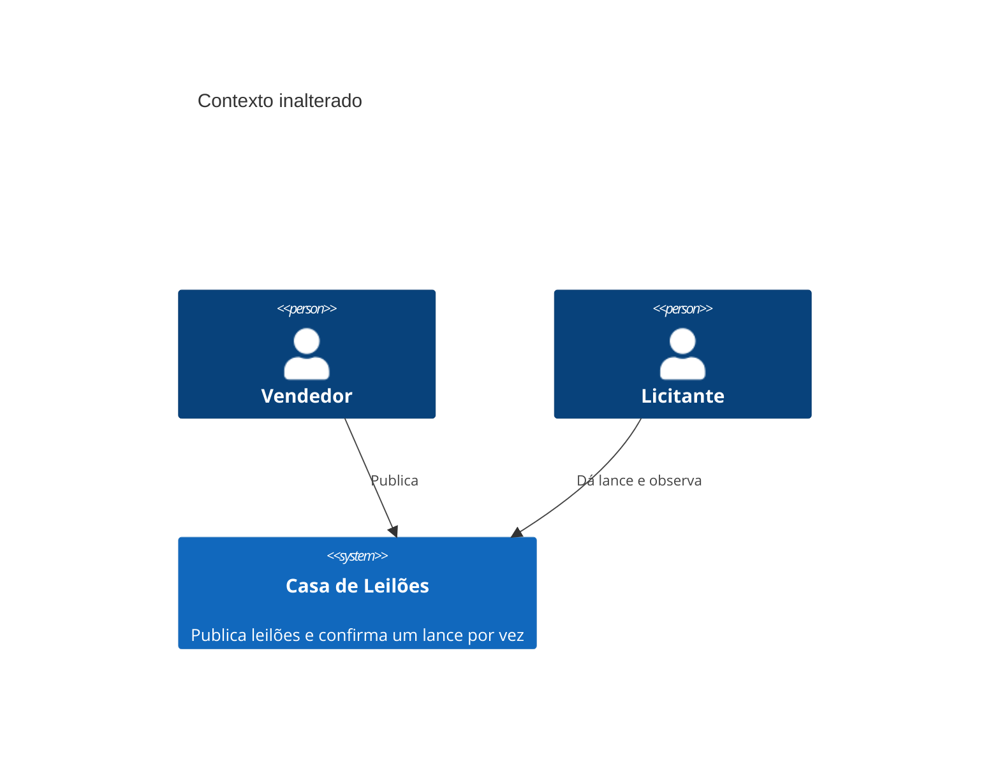
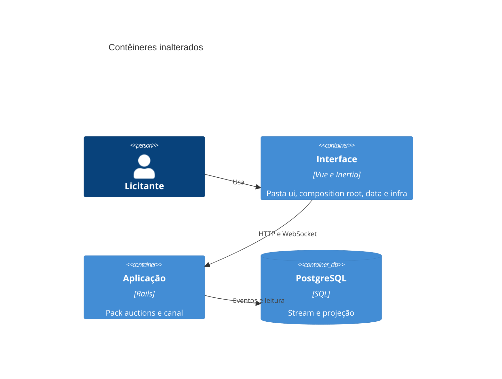
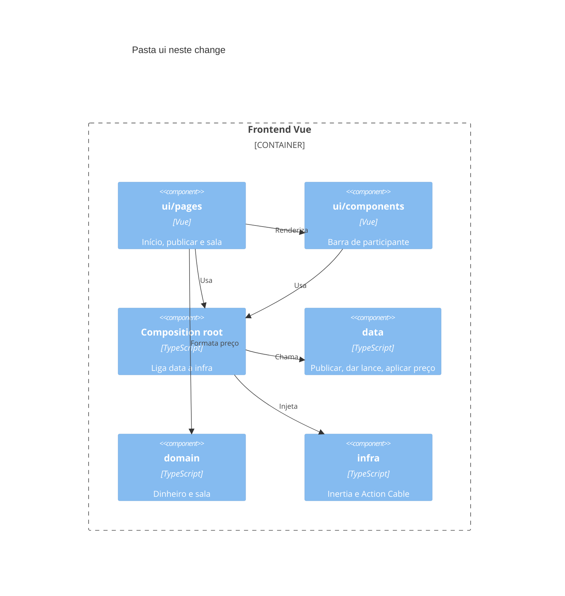

# Diagramas C4

O recorte só agrupa a interface Vue. Contexto, pack `auctions`, banco, event store e canal permanecem.

## Contexto

## Contêineres

## Componentes

## Fronteiras entre packs

- O pack `auctions` continua o único bounded context. A web chama a API pública e não importa `data` nem `infra` do pack.
- `ui` não importa o cliente do Action Cable nem o adapter HTTP.
- `domain` do frontend não importa Vue, Inertia nem Action Cable.
- `data` depende de domínio e de portas. `infra` implementa as portas.
- O composition root fica fora de `ui` e é o único lugar que liga `data` a `infra`.
