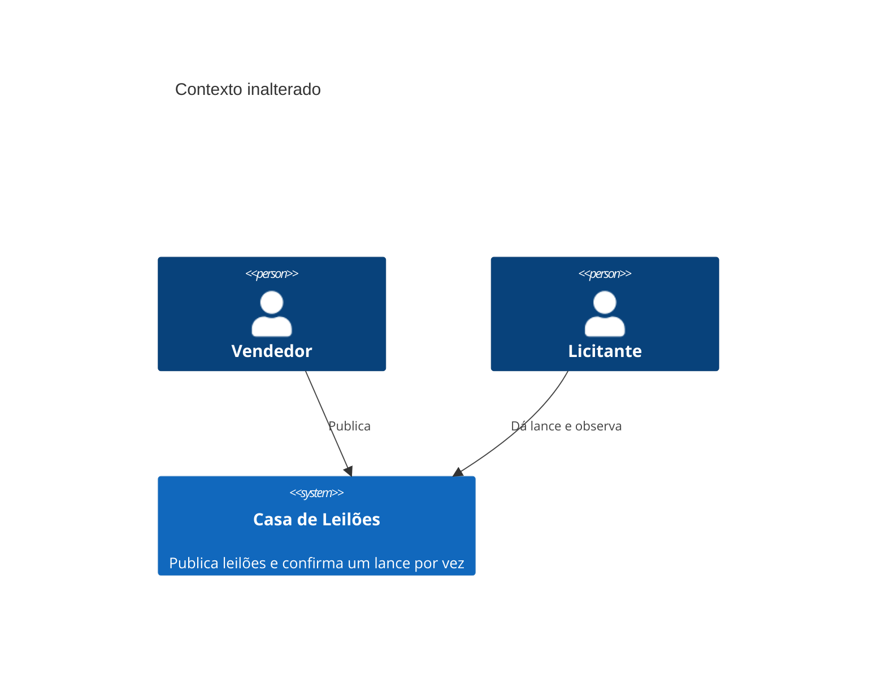
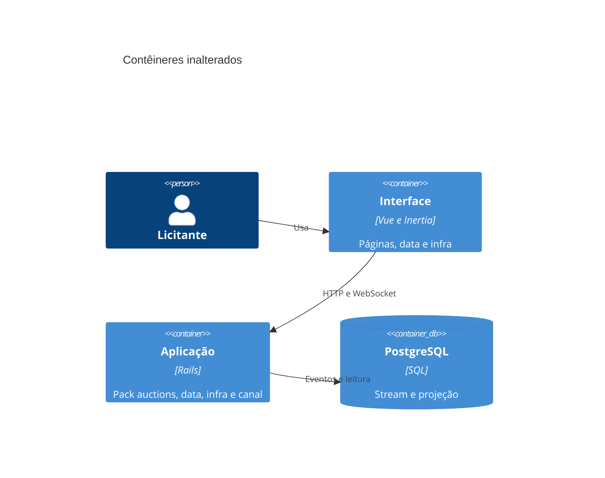
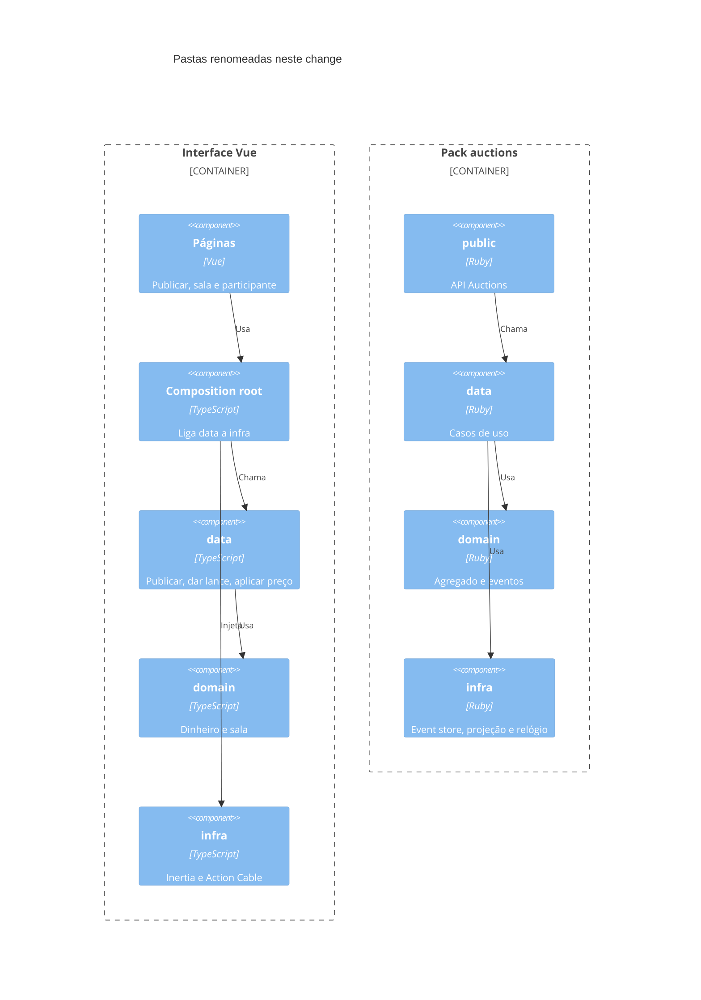

# Diagramas C4

O recorte troca o nome de duas pastas no navegador e no pack `auctions`. Contexto, banco, event store e canal permanecem.

## Contexto

## Contêineres

## Componentes

## Fronteiras entre packs

- O pack `auctions` continua o único bounded context. A web chama a API pública e não importa `data` nem `infra` do pack.
- `domain` do pack não referencia Rails, Inertia nem Action Cable.
- `domain` do frontend não importa Vue, Inertia nem Action Cable.
- `data` depende de domínio e de portas. `infra` implementa as portas e fala com event store, projeção ou canal.
- `pages` não importa o cliente do canal.
