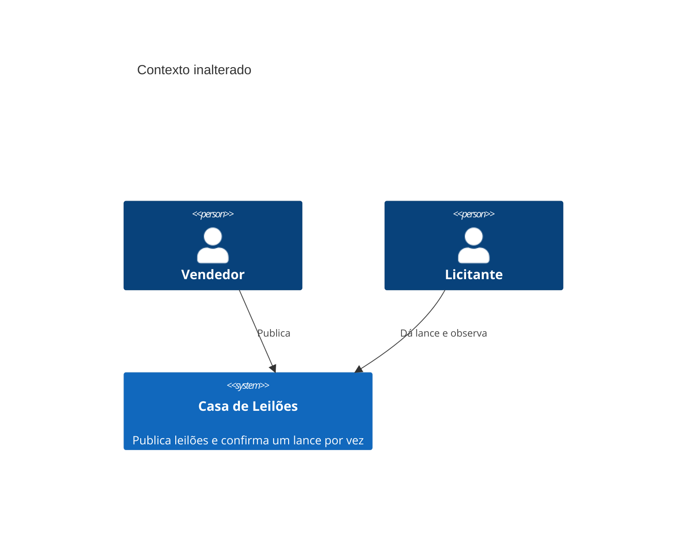
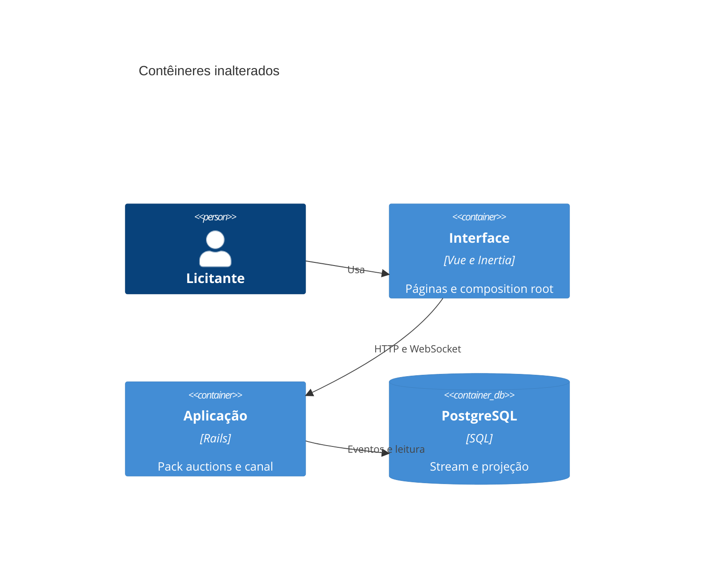
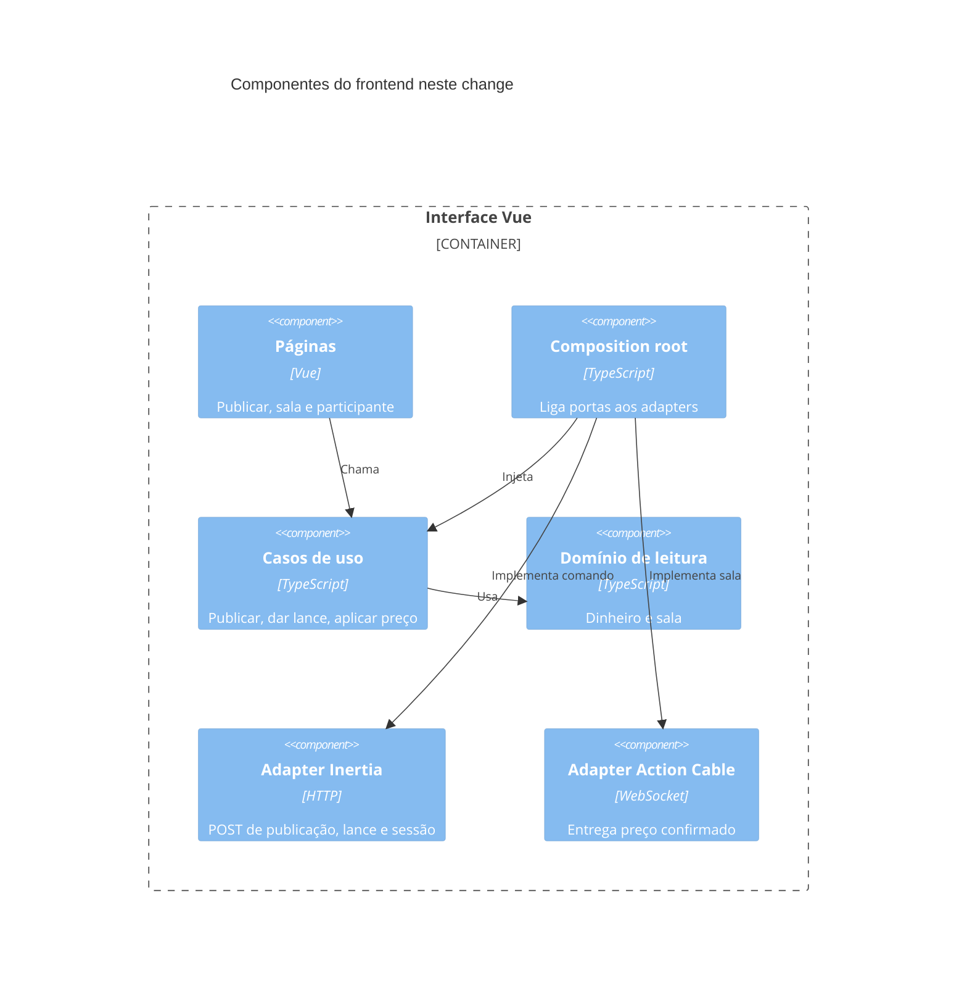

# Diagramas C4

O navegador continua sendo um contêiner. Este change só separa os componentes dentro dele. O pack `auctions` e o Action Cable permanecem como no RFC arquivado.

## Contexto

## Contêineres

## Componentes

## Fronteiras entre packs

- `domain` não importa `vue`, `@inertiajs/vue3` nem `@rails/actioncable`.
- `application` importa domínio e interfaces de porta, não os adapters.
- `infrastructure` importa as bibliotecas externas e implementa as portas.
- `pages` importa casos de uso ou funções já compostas, não o cliente do canal.
- Nenhuma dessas pastas importa classe do pack Rails `auctions`.
